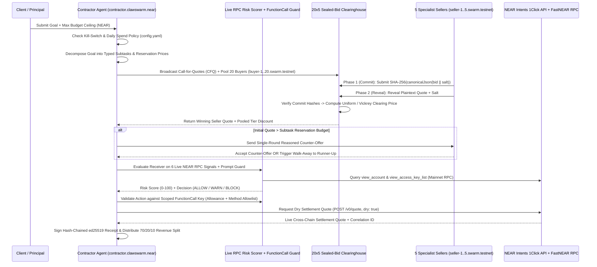

# ClawSwarm Nexus — Formal Market, Negotiation & Security Rules (`RULES.md`)

This document specifies the deterministic rules governing the **ClawSwarm Nexus** autonomous contractor loop, the **20-Buyer × 5-Seller Commit-Reveal Sealed-Bid Swarm Market** (Track `05-swarms`), the **Live RPC Counterparty Firewall & Scoped `FunctionCall` Key Guard** (Track `06-security`), and the **Autonomous Business Policy & Revenue Ledger** (Track `04-business` & Track `07-agents`).

---

## 1. End-to-End Architecture & Sequence Flow

---

## 2. Sealed-Bid Swarm Clearinghouse Rules (`05-swarms`)

### 2.1 Participant Roster
- **Buyers (`20` sub-accounts):** `buyer-1.swarm.testnet` through `buyer-20.swarm.testnet`. Each buyer submits a task unit demand $q_i \in [1, 10]$ and a maximum willingness-to-pay (reservation price) $v_i$ in NEAR per unit.
- **Sellers (`5` specialist solver sub-accounts):** `seller-1.swarm.testnet` through `seller-5.swarm.testnet`. Each seller submits a unit ask price $a_j$ in NEAR, maximum capacity $C_j$, verifiable TEE attestation capability flag, and bulk discount tier (`discountBps` unlocked when pooled buyer count $N_{\text{buyers}} \ge 3$).

### 2.2 Three-Phase Commit-Reveal Protocol
1. **Phase 1 — Cryptographic Commitment:**
   Every buyer $i$ and seller $j$ publishes a commitment hash prior to the reveal deadline:
   $$\text{commitHash} = \text{SHA-256}\left(\text{UTF8}\left(\text{accountId} \mathbin{\|} \text{role} \mathbin{\|} \text{unitPriceNear} \mathbin{\|} \text{quantity} \mathbin{\|} \text{salt}\right)\right)$$
2. **Phase 2 — Plaintext Reveal & Integrity Verification:**
   Participants submit plaintext parameters and `salt`. The clearinghouse recomputes `SHA-256` for each entry. Any reveal whose recomputed digest does not match `commitHash` is **immediately disqualified** (`status: REJECTED_COMMIT_MISMATCH`).
3. **Phase 3 — Demand Pooling & Uniform Second-Price (Vickrey-Adjusted) Clearing:**
   - **Demand Sorting:** Validated buyers are sorted in descending order of reservation price $v_i$.
   - **Supply Sorting:** Validated sellers are sorted in ascending order of effective ask price $\tilde{a}_j = a_j \cdot (1 - \text{bulkDiscount}_j)$, where $\text{bulkDiscount}_j$ activates whenever at least 3 buyers pool demand into the batch.
   - **Market Intersection:** Aggregate demand $D(p)$ and aggregate supply $S(p)$ are matched while $v_i \ge \tilde{a}_j$.
   - **Clearing Price Formula:** Let $j^*$ be the marginal (last-matched) seller and $j^*+1$ be the first competitive excluded seller (or the marginal buyer reservation price $v_{\text{marginal}}$ if all sellers clear). The uniform clearing price is:
     $$P_{\text{clear}} = \min\left(v_{\text{marginal}},\; \frac{\tilde{a}_{j^*} + \min(v_{\text{marginal}}, \tilde{a}_{j^*+1})}{2}\right)$$
   - **Tie-Breaking Rule:** Deterministic lexicographical sort on `(effectiveAskNear ASC, reputationScore DESC, commitmentHash ASC)`.
   - **Pro-Rata Settlement Allocation:** Every matched buyer $i$ pays exactly $q_{i,\text{filled}} \times P_{\text{clear}}$ NEAR, saving $(v_i - P_{\text{clear}}) \times q_{i,\text{filled}}$ NEAR in consumer surplus.

---

## 3. Single-Round Contractor Negotiation Rules (`07-agents`)

1. **Make-vs-Buy Evaluation:**
   Before hiring an external specialist, the Contractor Agent compares its internal execution cost $C_{\text{internal}}$ (derived from live `NEAR.AI` TEE model token rates) against the best swarm clearing quote $P_{\text{quote}}$.
2. **Reservation Ceiling & Counter-Offer Trigger:**
   Each subtask $k$ has a target reservation budget $B_k^{\text{target}}$ and a hard walk-away ceiling $B_k^{\text{max}}$.
   - If $P_{\text{quote}} \le B_k^{\text{target}}$: **Immediate Acceptance** (`ACCEPTED_INITIAL`).
   - If $P_{\text{quote}} > B_k^{\text{target}}$: The Contractor issues **at most 1 reasoned counter-offer**:
     $$P_{\text{counter}} = \text{round}_4\left(\max\left(B_k^{\text{target}} \cdot 0.96,\; P_{\text{quote}} \cdot (1 - \delta_{\text{target}})\right)\right)$$
     accompanied by market evidence (competitor median ask and pooled buyer volume).
   - If the primary seller's floor price $P_{\text{floor}} \le P_{\text{counter}}$: Seller accepts (`ACCEPTED_COUNTER`).
   - If $P_{\text{floor}} > P_{\text{counter}}$: Contractor **walks away** (`WALKED_AWAY_REASSIGNED`) and routes execution to the runner-up seller whose effective ask satisfies $\le B_k^{\text{max}}$, or falls back to local execution.

---

## 4. Live RPC Counterparty Risk Scorer & Scoped `FunctionCall` Key Guard (`06-security`)

### 4.1 Six-Signal On-Chain Risk Scoring Matrix (`0` to `100`)
Before signing any payment or intent settlement to `receiverId`, the firewall queries live NEAR RPC (`view_account` and `view_access_key_list`) and computes:

| Signal ID | Telemetry Source | Condition Evaluated | Risk Weight |
| :--- | :--- | :--- | :---: |
| `SIG-01` | Shared Evidence Registry | `receiverId` matches known high-risk / fee-siphon registry | `+55` |
| `SIG-02` | Account Naming Structure | 64-char hex implicit account (` /^[0-9a-f]{64}$/ `) for transfer $> 2.5$ NEAR | `+25` |
| `SIG-03` | RPC `view_account` Existence | Account does not exist on-chain or RPC returns `UNKNOWN_ACCOUNT` | `+30` |
| `SIG-04` | RPC `code_hash` & `storage_usage` | Unverified EOA (`code_hash == 1111..1111`) or ephemeral storage ($< 1,000$ bytes) receiving contract call | `+20` |
| `SIG-05` | RPC Liquid Balance Anomaly | Receiver liquid balance $< 0.05$ NEAR (dust sweep pattern) | `+15` |
| `SIG-06` | Prompt-Boundary Instruction Filter | Task payload or memo contains instruction-override markers (`IGNORE PREVIOUS`, `AddKey`, `FullAccess`, `override_policy`) | `+65` |

### 4.2 Deterministic Policy Thresholds
- **Score `0 – 34` (`ALLOW`):** Transaction proceeds to scoped `FunctionCall` key validation.
- **Score `35 – 69` (`WARN`):** Transaction requires explicit cap reduction ($\le 1.0$ NEAR) and logs an elevated telemetry receipt.
- **Score `70 – 100` (`BLOCK`):** Execution halts immediately prior to signing; emits a signed `SECURITY_BLOCK` receipt.

### 4.3 Structural `FunctionCall` Access Key Enforcement
Even if an upstream planner requests an unauthorized action, the signing guard enforces NEAR's protocol-level `FunctionCallPermission` invariants:
1. **Action Type Restriction:** Only `FunctionCall` actions are permitted. Any `Transfer`, `AddKey`, `DeleteKey`, `DeleteAccount`, or `DeployContract` action is deterministically rejected (`ERR_ACTION_NOT_FUNCTION_CALL`).
2. **Receiver Pinning:** `tx.receiverId` must strictly match `permission.receiverId` (or an approved `.swarm.testnet` / `intents.near` settlement router).
3. **Method Allowlist:** `tx.methodName` must belong to `permission.allowedMethods` (`["ft_transfer_call", "execute_intent", "settle_batch", "storage_deposit"]`).
4. **Remaining Allowance Ceiling:** $\text{cumulativeSpentNear} + \text{txDepositNear} \le \text{permission.allowanceNear}$.

---

## 5. Autonomous Business Policy & Revenue Split (`04-business`)

Every completed client job updates the hash-chained business ledger:
- **Gross Revenue ($R_{\text{gross}}$):** Client contracted budget in NEAR.
- **Direct Solver & Settlement Cost ($C_{\text{direct}}$):** Sum of negotiated subtask costs + `1Click` cross-chain settlement spread.
- **Net Operating Margin ($M_{\text{net}}$):** $R_{\text{gross}} - C_{\text{direct}}$.
- **Automated Distribution (`70 / 20 / 10` Split):**
  - `70%` (`7000 bps`) $\rightarrow$ `treasury.clawswarm.near` (Operator Retained Earnings)
  - `20%` (`2000 bps`) $\rightarrow$ `pool.clawswarm.near` (Specialist Solver Rebate Pool)
  - `10%` (`1000 bps`) $\rightarrow$ `reserve.clawswarm.near` (Security & Slippage Reserve Vault)
- **Kill-Switch Invariant:** When `killSwitchActive === true` or `dailyCumulativeSpend + taskCost > maxDailySpendNear`, all outbound execution halts in $O(1)$ before any external quote or RPC call is signed.
